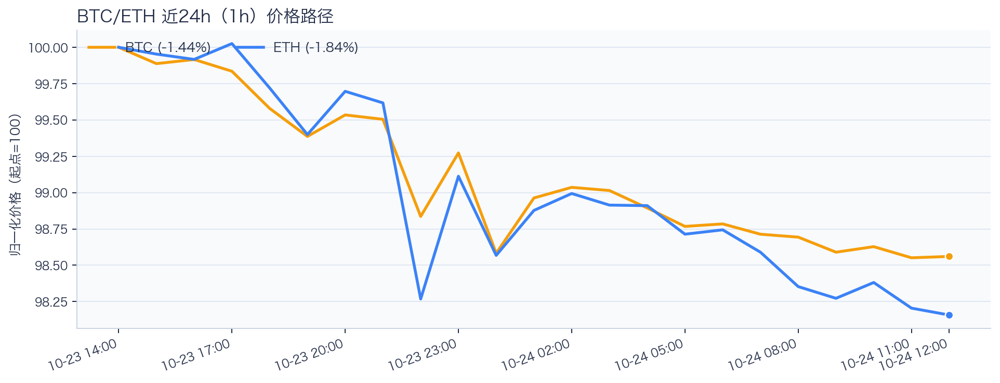
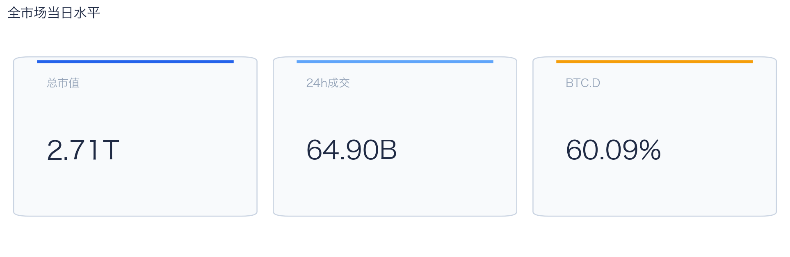
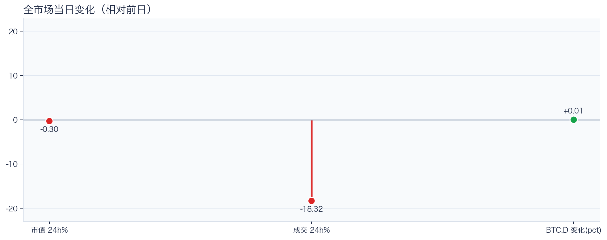
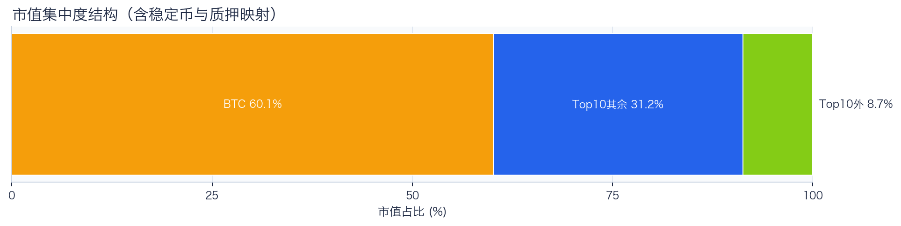
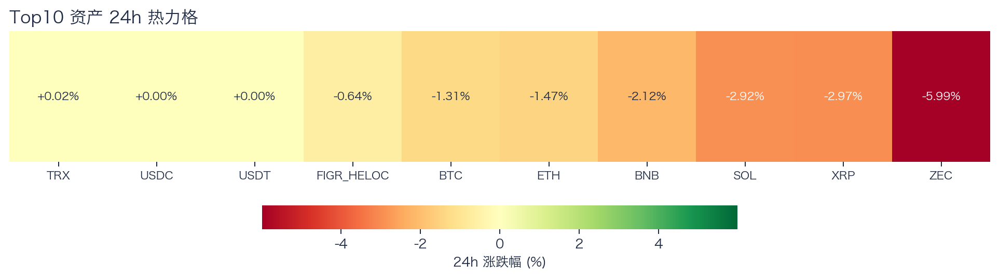
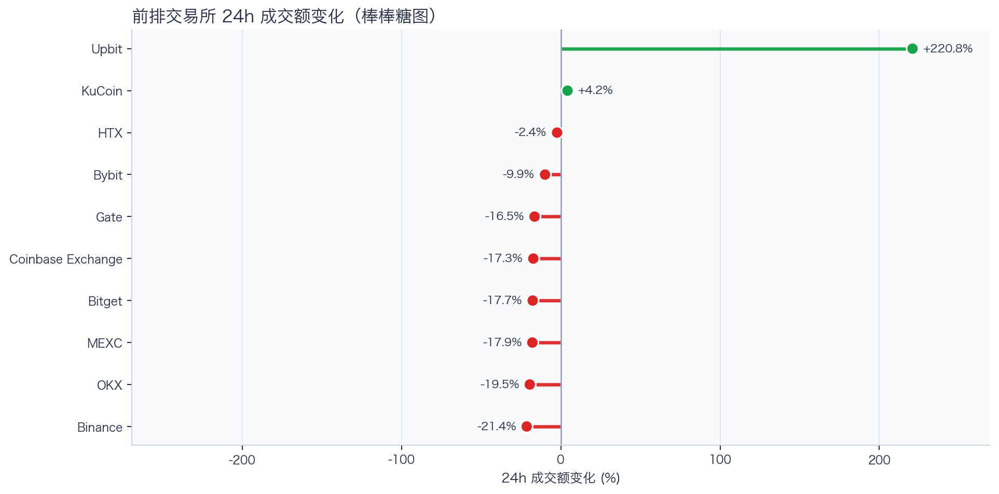
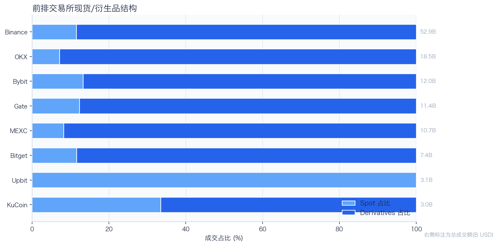
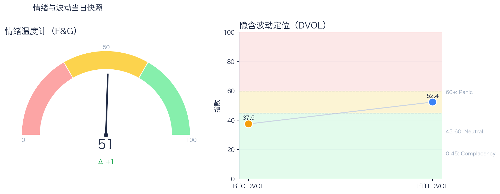

# 二级市场日报（2026-10-24）

## 快速结论
- 全市场指标当日：市值 $2.71T（24h -0.30%），成交额 $64.90B（24h -18.32%）。
- BTC 主导率 60.09%（+0.01pct），Top10 外市值占比（集中度口径）8.74%。
- 头部风险资产（排除稳定币、质押及信用映射）上涨 1 / 下跌 6 / 平盘 0，平均涨跌幅 -2.39%，首尾分化 6.02pct。
- 前排样本多数收缩：上涨 2 家、下跌 8 家；Upbit +220.81% 的极端值将样本均值拉至 +10.25%，不宜用均值概括整体方向。
- Tokenized Stocks 类别规模 $3.53B，7D +9.95%。

## 市场主线
今日市场状态为“防守下移”。价格与成交同步走弱，属于防守型下移结构，短线以控制回撤为主。头部风险资产下跌覆盖率较高，风险参与度偏弱。当前证据尚不足以确认新一轮趋势启动。

交易所成交方面，多数平台成交走弱，样本只支持成交收缩及降幅分化，不支持资金回流判断；杠杆方面，当前资金费率未显示极端拥挤，但单一平台样本不足以概括整体杠杆状态；期权定价方面，隐含波动率处于相对低位，但单凭 DVOL 不足以判断期权保护成本是否便宜；情绪方面，情绪与价格修复节奏尚未完全同步。几项指标共同用于确认市场状态，但暂不足以归因于特定事件。

## BTC/ETH 24h 趋势

口径：文字涨跌来自交易所 rolling 24h ticker；图内路径为当前可得 23 个小时点，首尾变化 BTC -1.44%、ETH -1.84%，两者窗口不可混用。
- BTC（交易所 rolling 24h）：$80,606.98（-1.25%，区间 $80,451.18 - $82,060.88，当前位于区间 10%）=> 偏弱震荡。
- ETH（交易所 rolling 24h）：$2,364.60（-1.43%，区间 $2,351.55 - $2,417.77，当前位于区间 20%）=> 偏弱震荡。
- 简评：BTC 与 ETH 同步走弱，短线仍以防守为主。

## 市场结构与交易状态
### 市场脉冲

当日，全市场市值 $2.71T，24h 成交额 $64.90B，BTC 主导率 60.09%。
价格与成交同步走弱，风险偏好仍在收缩，盘面更偏防守。

相对前一观测日，市值 -0.30%、成交 -18.32%、BTC.D +0.01pct。
市值与成交是同步观测；缺少事件时点和资金路径证据时，暂不作特定事件归因。

### 市场广度与集中度

当前市值结构为 BTC 60.09% / Top10 其余 31.17% / Top10 外 8.74%。该图含稳定币与质押映射，只描述集中度，不证明风险偏好扩散。
方向样本为 7 个头部风险资产，已排除 USDT, USDC, FIGR_HELOC；Top10 外占比仅是市值集中度，不作为风险扩散代理。

### 资产与交易结构

按头部资产统一快照口径，领涨的是 TRX（+0.02%），跌幅最大的是 ZEC（-5.99%），均值 -2.39%，首尾相差 6.02pct。
下跌家数占优，风险偏好修复仍较脆弱，短线追高性价比一般。对交易而言，优先控制回撤并等待上涨覆盖率改善。

前排样本多数收缩：上涨 2 家、下跌 8 家；Upbit +220.81% 的极端值将样本均值拉至 +10.25%，不宜用均值概括整体方向。Binance 最弱（-21.43%）。
最强与最弱平台的 24h 变化差达到 242.24pct，说明平台间成交变化分化，但不能据此推断资金因果流向。报价连续性和滑点是否同步变化仍需盘口数据验证，执行层面应继续监控成交质量。

样本内衍生品成交占比 85.09%。该比例描述成交结构，不单独用于判断后续波动方向或幅度。
衍生品占比处于高位；该比例本身不说明波动方向。后续需用盘口深度、强平和事件窗口数据验证具体传导机制。

### 杠杆与风险定价
Deribit 样本的资金费率（Funding）接近中性，BTC/ETH 8h 费率分别为 +0.37bps / +0.00bps；隐含波动率指数（DVOL）位于 Complacency（低波动定价） / Neutral（中性波动定价）。
| 资产 | OKX 多头清算样本 | OKX 空头清算样本 | 近月年化基差 | 远月年化基差 | ATM IV | 25Δ 偏度 |
|---|---:|---:|---:|---:|---:|---:|
| BTC | $266,558 | $28,116 | +8.10% | +5.65% | 36.54% | 4.85 pp |
| ETH | $836,261 | $18,181 | +2.24% | +2.95% | 50.95% | 5.72 pp |
清算口径：仅为 OKX 公共接口返回的近期样本，不代表 OKX 或全市场清算总量；25Δ 偏度定义为 Put IV 减 Call IV。
Funding 未显示极端方向拥挤；DVOL 当前处于低波动/中性定价，二者均不足以单独判断尾部风险是否重新抬升。因此更合适的做法不是激进追单边，而是围绕波动管理仓位和节奏。

恐惧与贪婪指数（F&G）当日 51（较前一观测日 +1）；BTC/ETH DVOL 为 37.47/52.38，对应 Complacency（低波动定价） / Neutral（中性波动定价）。
情绪处于中性区，后续需要成交和广度同步改善才能确认趋势。若情绪、广度和成交三者同步改善，市场从“反弹交易”切换到“趋势交易”的置信度才会提高；若不同步，仍应降低对追涨信号的置信度。

### 关键价位与失效条件
| 资产 | 24h 支撑 | 24h 阻力 | ATR14(1h) | 向上触发 | 多头失效 | 向下触发 | 空头失效 |
|---|---:|---:|---:|---:|---:|---:|---:|
| BTC | 80451.18 | 82060.88 | 261.51 | 82141.49 | 81980.27 | 80370.57 | 80531.79 |
| ETH | 2351.55 | 2417.77 | 10.51 | 2420.40 | 2415.14 | 2348.92 | 2354.18 |
计算口径：以当前可得的 23 个小时点高低价作为支撑/阻力，触发缓冲取现价 0.1% 与 0.25×ATR14 的较大值；触发价用于观察确认，不是自动交易指令。

## 今日差异化重点
### 跨交易所 Funding 与 Carry
- Funding：样本高位为 OKX-BTC，年化约 10.95%。
- 平台分化：样本低位为 Binance-BTC，年化约 3.69%。
- 可执行性：Funding 与 basis 均有记录的样本可进入 carry 复核，但仍需检查手续费、滑点、保证金和持续性。

### 稳定币收益与资金成本
- 收益端：本期可得协议样本中，Aave-USDC（Base）的 Total APY 为 6.51%；Aave-USDC（Ethereum）为 5.72%，需继续区分原生利率与奖励补贴。
- 资金需求：本期可得样本最高利用率 94.04%；高利用率意味着借款需求较强，也可能压缩退出流动性。
- 跨平台成本：本期可得报价中，USDC 借币年化样本差约 2.24pct，适合继续核对额度、期限和地区准入，不直接视为套利利差。

## 未来24小时观察
1. 若头部风险资产上涨覆盖率连续改善且 BTC.D 回落，再结合更广币种样本验证风险偏好是否扩散。
2. 若衍生品占比继续上升而 funding 仍中性，只能确认交易向杠杆侧集中；是否放大波动仍需结合 DVOL 与成交验证。
3. 若 F&G 回升而 DVOL 不降，代表情绪改善尚未获得风险定价确认，应降低对追涨信号的置信度。

## 交易与风控含义
- 仓位管理优先级高于方向押注，建议保持核心仓位稳定、战术仓位滚动。
- 若衍生品占比上升并伴随 Funding 快速偏离中性或 DVOL 抬升，再考虑降低杠杆并收紧风险参数。
- 关注情绪改善与广度扩散是否同步发生，二者背离时避免追逐单边。
