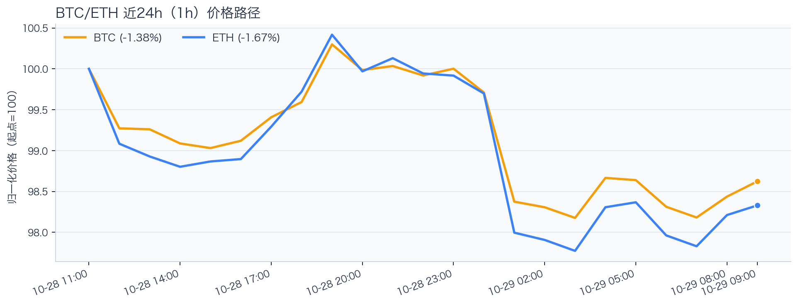
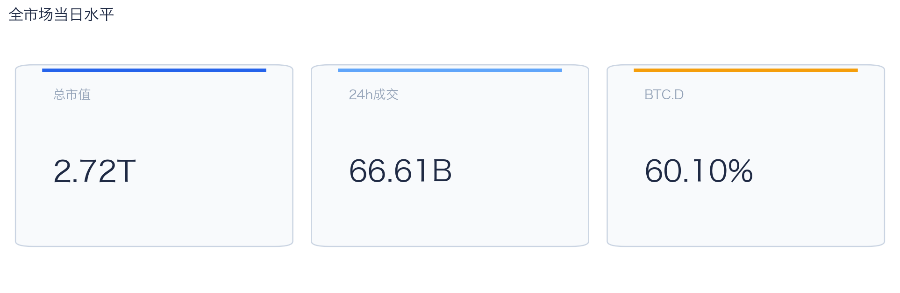
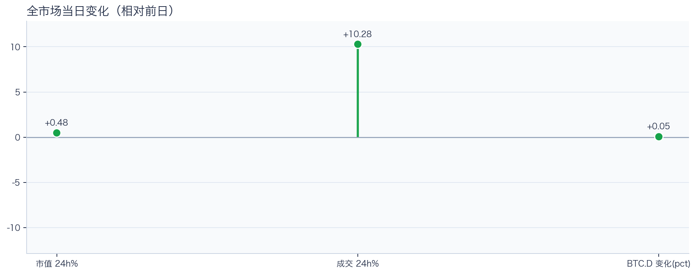
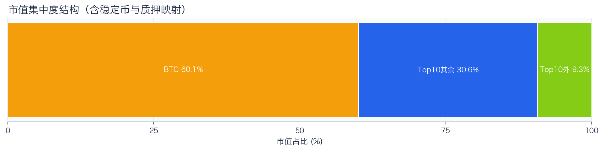
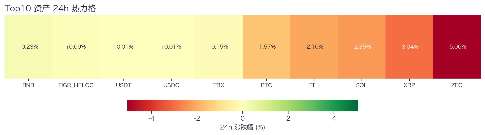
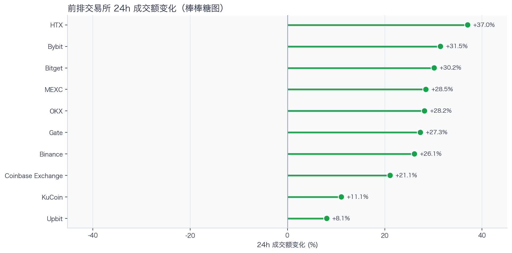
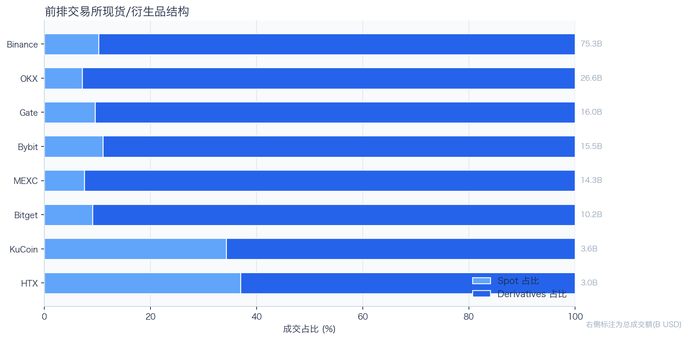
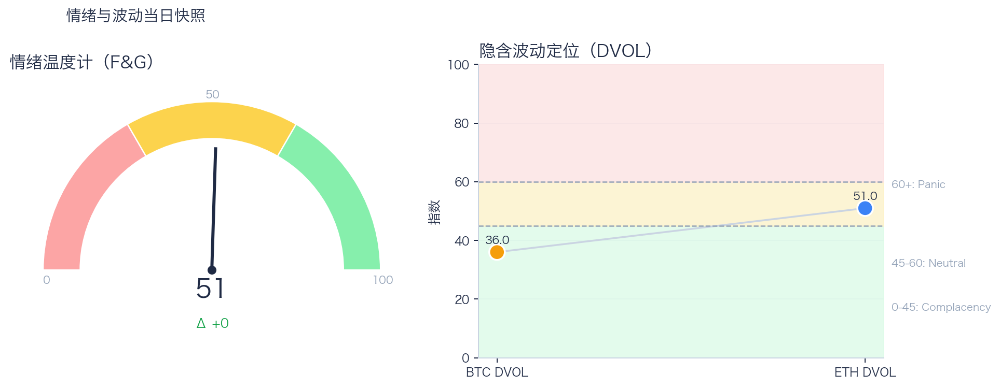

# 二级市场日报（2026-10-29）

## 快速结论
- 全市场指标当日：市值 $2.72T（24h +0.48%），成交额 $66.61B（24h +10.28%）。
- BTC 主导率 60.10%（+0.05 个百分点），Top10 外市值占比（集中度口径）9.29%。
- 头部风险资产（排除稳定币、质押及信用映射）上涨 1 / 下跌 6 / 平盘 0，平均涨跌幅 -2.00%，首尾分化 5.30 个百分点。
- 前排交易所样本成交额普遍回升：增加 10 家、减少 0 家，24h 成交额变化均值 +24.90%。
- Tokenized Stocks 类别规模 $3.77B，7D +15.50%。

## 市场主线
今日市场状态为“区间交易”。当日价格与成交额同步上行，但尚未形成可确认的持续趋势，市场仍处于区间内的结构轮动阶段。头部风险资产下跌覆盖率较高，风险参与度偏弱，当前证据不足以确认新一轮趋势启动。

交易所成交方面，多数平台样本成交额回升，但盘口深度、报价连续性与滑点尚未验证，不能直接等同于流动性改善；杠杆方面，当前资金费率未显示极端拥挤，但单一平台样本不足以概括整体杠杆状态；期权定价方面，隐含波动率处于相对低位，但单凭 DVOL 不足以判断期权保护成本是否便宜；情绪方面，情绪与价格修复节奏尚未完全同步。上述指标可共同用于刻画市场状态，但暂不足以归因于特定事件。

## BTC/ETH 24h 趋势

口径：文字涨跌来自交易所 rolling 24h ticker；图内路径为当前可得的 23 个 1 小时数据点，首尾变化 BTC -1.38%、ETH -1.67%，两者窗口不可混用。
- BTC（交易所 rolling 24h）：$80,221.02（-1.56%，区间 $79,710.00 - $81,788.56，当前位于区间 25%）=> 偏弱震荡。
- ETH（交易所 rolling 24h）：$2,322.17（-2.06%，区间 $2,293.44 - $2,391.55，当前位于区间 29%）=> 偏弱，下行主导。
- 简评：BTC 与 ETH 同步走弱，短线仍以防守为主。

## 市场结构与交易状态
### 市场脉冲

当日，全市场市值 $2.72T，24h 成交额 $66.61B，BTC 主导率 60.10%。
价格与成交额同步上行，呈现修复型结构；若次日成交额不明显回落，修复延续的信号强度将有所提高。

相对前一观测日，市值 +0.48%、成交 +10.28%、BTC.D +0.05 个百分点。
市值与成交是同步观测；缺少事件时点和资金路径证据时，暂不作特定事件归因。

### 市场广度与集中度

当前市值结构为 BTC 60.10% / Top10 其余 30.61% / Top10 外 9.29%。该图含稳定币与质押映射，只描述集中度，不证明风险偏好扩散。
方向样本为 7 个头部风险资产，已排除 USDT、USDC 和 FIGR_HELOC；Top10 外占比仅是市值集中度，不作为风险扩散代理。

### 资产与交易结构

按头部资产统一快照口径，领涨的是 BNB（+0.23%），跌幅最大的是 ZEC（-5.06%），均值 -2.00%，首尾相差 5.30 个百分点。
下跌家数占优，风险偏好修复仍较脆弱，短线追高的风险收益比不占优。对交易而言，优先控制回撤并等待上涨覆盖率改善。

前排样本中，成交额增加 10 家、减少 0 家，24h 成交额变化均值为 +24.90%。HTX 增幅最高（+37.04%），Upbit 增幅最低（+8.09%）。
增幅最高与最低平台之间相差 28.96 个百分点，说明平台间成交变化存在分化，但不能据此推断资金流向。报价连续性和滑点是否同步改善，仍需盘口数据验证；执行层面应继续监控成交质量。

样本内衍生品成交占比为 88.34%，该比例仅描述成交结构，不单独用于判断后续波动方向或幅度；具体传导机制仍需结合盘口深度、强平和事件窗口数据验证。

### 杠杆与风险定价
Deribit 样本的资金费率（Funding）接近中性，BTC/ETH 8h 费率分别为 +0.43bps / +0.00bps；隐含波动率指数（DVOL）位于 Complacency（低波动定价） / Neutral（中性波动定价）。
| 资产 | OKX 多头清算样本 | OKX 空头清算样本 | 近月年化基差 | 远月年化基差 | ATM IV | 25Δ 偏度 |
|---|---:|---:|---:|---:|---:|---:|
| BTC | $137,121 | $330,665 | +6.35% | +5.49% | 35.61% | 4.75 pp |
| ETH | $369,304 | $197,109 | +1.55% | +3.24% | 47.66% | 4.96 pp |
清算口径：仅为 OKX 公共接口返回的近期样本，不代表 OKX 或全市场清算总量；25Δ 偏度定义为 Put IV 减 Call IV。
资金费率与 DVOL 暂未显示极端方向拥挤；当前读数本身不足以判断尾部风险是否重新抬升。因此更合适的做法不是激进追单边，而是围绕波动管理仓位和节奏。

恐惧与贪婪指数（F&G）当日为 51，较前一观测日持平；BTC/ETH DVOL 为 36.00/50.99，对应 Complacency（低波动定价） / Neutral（中性波动定价）。
情绪处于中性区，后续需要成交和广度同步改善才能确认趋势。只有当情绪、广度和成交三者同时改善，市场才更可能从“反弹交易”切换到“趋势交易”。

### 关键价位与失效条件
| 资产 | 24h 支撑 | 24h 阻力 | ATR14(1h) | 向上触发 | 多头失效 | 向下触发 | 空头失效 |
|---|---:|---:|---:|---:|---:|---:|---:|
| BTC | 79710.00 | 81788.56 | 408.13 | 81890.59 | 81686.53 | 79607.97 | 79812.03 |
| ETH | 2293.44 | 2391.55 | 17.65 | 2395.96 | 2387.14 | 2289.03 | 2297.85 |
计算口径：以当前可得的 23 个 1 小时数据点的高低点作为支撑/阻力，触发缓冲取现价 0.1% 与 0.25×ATR14 的较大值；触发价用于观察确认，不是自动交易指令。

## 今日差异化重点
### 稳定币收益与资金成本
- 收益端：本期可得协议样本中，Aave-PYUSD 的 Total APY 为 13.40%，需继续区分原生利率与奖励补贴。
- 资金需求：本期可得样本最高利用率 94.16%；高利用率意味着借款需求较强，也可能压缩退出流动性。
- 跨平台成本：本期可得报价中，USDC 借币年化样本差约 2.47 个百分点，适合继续核对额度、期限和地区准入，不直接视为套利利差。

### RWA 与 24×7 映射交易
- 映射异动：GOOGL 24h -10.15%，属于今日 RWA 观察池中幅度较大的标的；底层市场非连续交易时不作溢折价结论。
- 类别结构：最近一次可得类别快照显示，Tokenized Stocks 规模约 $3.77B，7D +15.50%；该变化用于判断产品线活跃度，不直接外推大盘方向。
- 链上验证：公开聪明钱信号页在已覆盖标的中未命中活跃记录；这不等于不存在相关持仓或交易，异动仍需结合底层价格、成交与事件证据确认。

### 跨交易所资金费率与 Carry 收益
- 资金费率（Funding）：样本最高年化约 6.82%，对应 Binance-BTC。
- 平台分化：样本最低年化约 3.81%，对应 OKX-BTC。
- 可执行性：同时具备资金费率与基差（basis）记录的样本，可进入 Carry 收益复核；仍需检查手续费、滑点、保证金和持续性。

## 未来24小时观察
1. 若头部风险资产上涨覆盖率连续改善且 BTC.D 回落，再结合更广币种样本验证风险偏好是否扩散。
2. 若衍生品占比继续上升而资金费率仍中性，只能确认交易向杠杆侧集中；是否放大波动仍需结合 DVOL 与成交验证。
3. 若 F&G 回升而 DVOL 不降，代表情绪改善尚未获得风险定价确认，应降低对追涨信号的置信度。

## 交易与风控含义
- 仓位管理优先级高于方向押注，建议保持核心仓位稳定、战术仓位滚动。
- 若衍生品占比上升并伴随资金费率快速偏离中性或 DVOL 抬升，再考虑降低杠杆并收紧风险参数。
- 关注情绪改善与广度扩散是否同步发生，二者背离时避免追逐单边。
